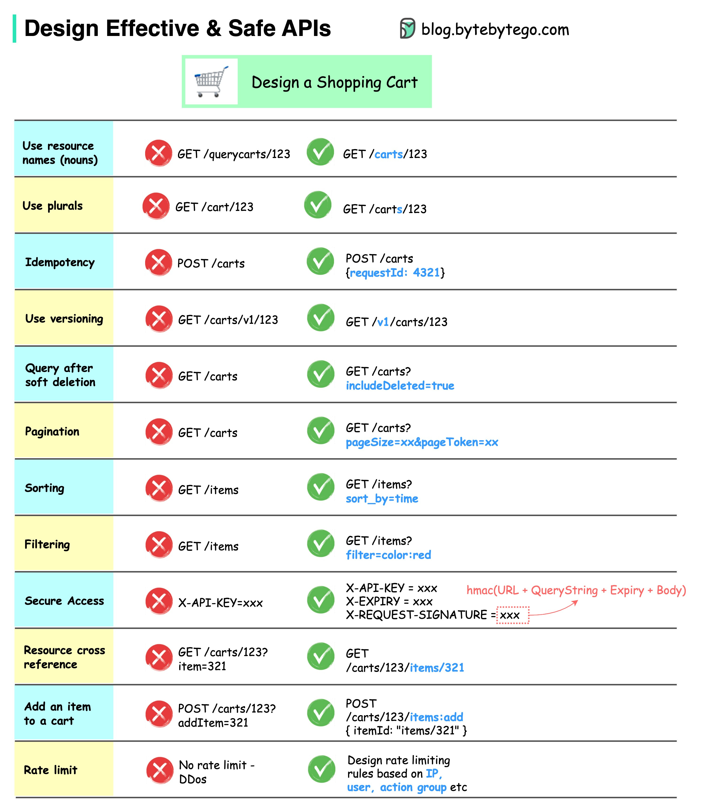

# API

## Documentation

- [Authentication](../authentication-architecture.md) — which caller each strategy serves, and what a service token reaches

## FastAPI Crud Endpoints

Order matters with endpoints, dynamic routes `route/endpoint/{id}` are last.
They even have to be after other endpoints:

1. `route/`
2. `route/endpoint/`
3. `route/endpoint/extension`
4. `route/{id}`
5. `route/endpoint/{id}`

The last two don't matter the order, only that they are after all of the endpoints that do not take in a path variable.

## Endpoint Structure

### GET vs POST vs PUT for Updating Resources

In RESTful API design, it's common to use a POST or PUT request when you want to update a resource.

A `GET` request should be idempotent, meaning that making the same request multiple times should have the same effect as making it once. In your case, marking a task as complete changes the state of the task, so a `GET` request would not be appropriate.

Between `POST` and `PUT`, the choice depends on whether you consider marking a task as complete to be a partial update of the task or a creation of a new state for the task.

If you consider it to be a partial update, you should use a `PUT` request. If you consider it to be a creation of a new state, you should use a `POST` request.

Completing a task is `PATCH /tasks/{task_id}/complete`: it changes one field of an existing task, so it is a partial update.

### Endpoint Resource vs Action Order

An action on one resource goes after its id: `/tasks/{task_id}/complete`, never `/tasks/complete/{task_id}`.

This is because in REST, URLs are used to represent resources, and the components of the URL are used to form a hierarchy of resources. In this case, the task with a specific task_id is the resource, and complete is an action on that resource. So, it makes sense to structure the URL as `/tasks/{task_id}/complete`, where complete is a sub-resource of the task.

### PUT vs PATCH

In RESTful API design, PUT and PATCH are both used to update a resource, but they are used in slightly different ways:

PUT is used to update a resource with a complete new version. It's idempotent, meaning that making the same PUT request multiple times will have the same effect as making it once. If you PUT a resource and then PUT it again with the same data, the second request will have no effect.

PATCH, on the other hand, is used to update a resource with a partial update. It's not idempotent by nature, meaning that making the same PATCH request multiple times may have different effects. For example, if you PATCH a resource to increment a counter, making the same PATCH request again will increment the counter again.

In RESTful API design, a successful `PATCH` request typically returns a `200 OK` status code along with the updated resource. This allows the client to see the changes that were made, which might be different from the changes that were requested if some of the changes couldn't be applied.

However, if the `PATCH` request doesn't return the updated resource, it should return a `204 No Content` status code to indicate that the request was successful but there's no representation to return (i.e., no body).

## Good API Design

