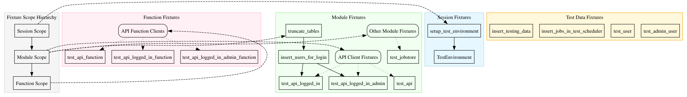

# Test Fixtures

This document details the test fixtures available in the ichrisbirch project's testing infrastructure. These fixtures provide standardized ways to set up test prerequisites and resources.

## Fixture Scopes

The project uses fixtures at different scopes to optimize test execution:



## Session Fixtures

Session fixtures run once per test session and are available throughout the testing process:

### `setup_test_environment`

- **Scope**: Session
- **Autouse**: Yes
- **Description**: Starts this session's own Postgres and Redis and brings the schema to head
- **Implementation**: Defined in `conftest.py`; enters `PrivateServices` from `tests/environment.py`, which [Test Environment](environment.md) describes

```python file=tests/conftest.py element=setup_test_environment label="setup_test_environment"
@pytest.fixture(scope='session', autouse=True)
def setup_test_environment():
    """Start this session's own Postgres and Redis, and bring the schema to head."""
    logger.warning('')
    logger.warning(f'{"=" * 30}>  STARTING TESTING  <{"=" * 30}')
    logger.warning('')

    with PrivateServices(test_settings) as services:
        yield services

    logger.warning('')
    logger.warning(f'{"=" * 30}>  TESTING FINISHED  <{"=" * 30}')
    logger.warning('')
```

## Module Fixtures

Module fixtures run once per test module:

### `truncate_tables`

- **Scope**: Session
- **Description**: Cleans all tables via TRUNCATE at session start, so the rows the migrations seed never reach a test
- **Implementation**: Truncates every table with `truncate_all_tables()`, then re-inserts the rows the app cannot run without. The fixture body in `tests/conftest.py` lists them.

### `insert_users_for_login`

- **Scope**: Module
- **Autouse**: Yes
- **Description**: Inserts test login users needed for Flask/API authentication fixtures
- **Dependencies**: `truncate_tables`
- **Implementation**: Inserts predefined test users from `get_test_login_users()`

### Test Users

There are two separate sets of users, each serving a different purpose:

| Set | Users | Source | Purpose |
| --- | --- | --- | --- |
| **Default users** | `user@icb.com`, `admin@icb.com` | `insert_default_users()` in `initialization.py` | Application users for dev, E2E tests, Authelia auth simulation |
| **Test login users** | `sacrifice@testgods.com`, `testloginregular@testuser.com`, `testloginadmin@testadmin.com` | `get_test_login_users()` in `tests/utils/database.py` | Pytest-specific users for Flask login and API auth fixtures |

Default users are re-inserted after truncation, so the API container always has valid users. Test login users are inserted by the `insert_users_for_login` fixture. Both sets must be accounted for in tests that assert user counts.

### Test Client Fixtures (Module Scope)

Various test client fixtures provide access to the API and App with different authentication levels:

| Fixture Name | Description | Authentication |
| --- | --- | --- |
| `test_api` | Basic API test client | None |
| `test_api_logged_in` | API client with regular user authentication | Regular user |
| `test_api_logged_in_admin` | API client with admin authentication | Admin user |
| `test_app` | Basic App test client | None |
| `test_app_logged_in` | App client with regular user authentication | Regular user |
| `test_app_logged_in_admin` | App client with admin authentication | Admin user |

### `test_jobstore`

- **Scope**: Module
- **Description**: Provides access to the APScheduler job store for testing scheduler functionality
- **Implementation**: Calls `get_jobstore()` with test settings

## Function Fixtures

Function fixtures run once per test function:

### Test Client Fixtures (Function Scope)

These fixtures are function-scoped versions of the module-scoped test client fixtures:

| Fixture Name | Description | Authentication |
| --- | --- | --- |
| `test_api_function` | Function-scoped basic API client | None |
| `test_api_logged_in_function` | Function-scoped API client with regular user auth | Regular user |
| `test_api_logged_in_admin_function` | Function-scoped API client with admin auth | Admin user |
| `test_app_function` | Function-scoped basic App client | None |
| `test_app_logged_in_function` | Function-scoped App client with regular user auth | Regular user |
| `test_app_logged_in_admin_function` | Function-scoped App client with admin auth | Admin user |

## Test Data Fixtures

Test data fixtures handle the insertion and cleanup of test data:

### `insert_testing_data`

- **Autouse**: Often set to `True` in individual test modules
- **Description**: Inserts specific test datasets and cleans them up after tests
- **Implementation**: Uses `insert_test_data()` and `delete_test_data()` functions
- **Example**:

k

```python file=tests/utils/database.py element=insert_test_data label="insert_testing_data"
def insert_test_data(*datasets):
    test_data = get_test_data()
    selected_datasets = [deepcopy(test_data[key]['data']) for key in datasets]

    with create_session(test_settings) as session:
        for data in selected_datasets:
            session.add_all(data)
        session.commit()
    for d in datasets:
        logger.info(f'inserted testing dataset: {d}')
```

### `insert_jobs_in_test_scheduler`

- **Description**: Adds test jobs to the scheduler for testing scheduler functionality
- **Implementation**: Creates a test scheduler and adds jobs from test data

### User Fixtures

- **`test_user`**: Provides a test user instance
- **`test_admin_user`**: Provides a test admin user instance

## Using Fixtures in Tests

To use fixtures in tests, you can either:

1. **Parameter Injection**: Add the fixture name as a parameter to your test function

   ```python
   def test_api_endpoint(test_api_logged_in):
       response = test_api_logged_in.get('/some-endpoint/')
       assert response.status_code == 200
   ```

2. **Autouse**: Mark fixtures with `autouse=True` to apply them automatically to all tests in scope

   ```python
   @pytest.fixture(autouse=True)
   def insert_testing_data():
       insert_test_data('tasks')
       yield
       delete_test_data('tasks')
   ```

## Fixture Dependencies

Fixtures can depend on other fixtures to build complex test setups. For example:

```python
@pytest.fixture
def test_feature(test_api_logged_in, insert_testing_data):
    # This fixture depends on both an authenticated API client
    # and test data being available
    ...
```

## Dynamic Fixture Analysis

The diagram at the top of this page is generated dynamically from the actual fixture code in the project. This ensures it always reflects the current state of the testing infrastructure. Additional visualizations of the fixture hierarchy:

- [Fixture Scope Hierarchy](../images/generated/fixture_scopes.svg) - Shows the pytest fixture scope levels
- [Fixture Dependencies](../images/generated/fixture_dependencies.svg) - Dependencies between fixtures
- [Comprehensive Fixture View](../images/generated/fixtures_comprehensive.svg) - Complete view of all fixtures
- [Session-scoped Dependencies](../images/generated/fixture_dependencies_session.svg) - Docker orchestration, table lifecycle, and test users
- [Module-scoped Dependencies](../images/generated/fixture_dependencies_module.svg) - The `test_api` clients and the scheduler
- [Function-scoped Dependencies](../images/generated/fixture_dependencies_function.svg) - The `*_function` fixtures that isolate a single test

## Best Practices

1. Use the appropriate fixture scope to optimize test performance
2. Keep fixtures focused on a single responsibility
3. Use `autouse=True` sparingly to avoid confusion
4. Document fixture dependencies clearly
5. Clean up test data in fixture teardown phases
