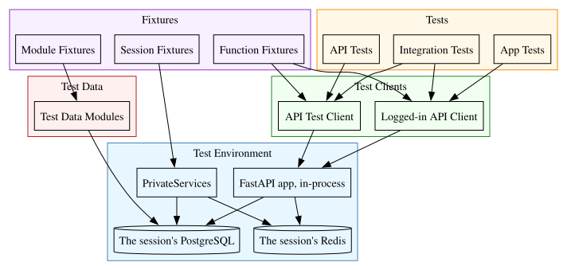

# Testing Infrastructure Overview

This document provides a comprehensive overview of the testing infrastructure in the ichrisbirch project. The testing infrastructure supports the FastAPI backend API and Vue 3 SPA frontend.

## Table of Contents

1. [Testing Architecture](#testing-architecture)
2. [Test Environment Setup](#test-environment-setup)
3. [Test Data Management](#test-data-management)
4. [Test Clients](#test-clients)
5. [Fixtures](#fixtures)
6. [Writing Tests](#writing-tests)
7. [Vue Frontend Testing](#vue-frontend-testing)
8. [Related Documentation](#related-documentation)

## Testing Architecture

The testing infrastructure follows a layered approach:



The architecture ensures that:

1. Tests run in a controlled, isolated environment
2. The API server is available for testing
3. Test data is managed consistently
4. Authentication and authorization can be tested effectively

## Test Environment Setup

pytest and Playwright each get an environment no other checkout shares.

- **pytest** starts its own Postgres and Redis for every session, on ports Docker picks, and removes them when the session ends. The API runs in-process.
- **Playwright** runs inside the checkout's own test stack, a compose project named `icb-test-<checkout directory>` that publishes no ports. Its Postgres is on tmpfs, so `testing stop` empties it.

[Test Environment](environment.md) covers both.

## Test Data Management

Test data comes from the `tests.test_data` package, which fixtures insert and delete around each module. pytest never runs the seeders. `scripts/seed/seeders/` fills the dev stack, and the test stack on request through `./ops/icbops testing db seed`.

## Test Clients

Test clients provide interfaces to interact with the API server:

1. **API Test Client**: Based on FastAPI's TestClient
2. **Authenticated clients**: Module-scoped fixtures for logged-in and admin access

## Fixtures

The testing infrastructure provides fixtures at different scopes:

1. **Session-scoped**: the session's own Postgres and Redis, table lifecycle, test users
2. **Module-scoped**: `test_api`, `test_api_logged_in`, `test_api_logged_in_admin`
3. **Function-scoped**: `*_function` suffix variants for test isolation

See the [fixtures documentation](fixtures.md) for more details.

## Writing Tests

See the [writing tests guide](writing_tests.md) for information on how to write effective tests using this infrastructure.

## Vue Frontend Testing

The Vue frontend uses a four-layer testing strategy:

| Layer | Tool | What it catches |
| --- | --- | --- |
| Build | `vue-tsc` + `vite build` | TypeScript errors, missing imports |
| Store/Unit | Vitest | Store logic, composables, utilities |
| Component | Vitest + `@pinia/testing` | View rendering, store wiring, modals |
| E2E | Playwright | CORS, Traefik routing, real CRUD |

### Build Verification (`npm run test:build`)

Runs `vue-tsc` (TypeScript checking) and `vite build` to catch:

- TypeScript errors and missing type declarations
- Missing imports and broken module resolution
- Dependencies installed on host but missing in Docker container

### Store/Unit Tests (`npm run test:unit`)

Vitest with Vue Test Utils. Tests Pinia stores, composables, and utility functions with mocked API calls.

- Located in `frontend/src/**/__tests__/` (store and composable directories)
- API mocked via `vi.mock('@/api/client')`

### Component Integration Tests (part of `npm run test:unit`)

Vitest with `@pinia/testing`. Mounts real Vue view components with controlled store state.

- Located in `frontend/src/views/__tests__/`
- Pattern: `createTestingPinia({ initialState, stubActions: true, createSpy: vi.fn })`
- Stub child components (modals, subnavs) and mock composables (`useNotifications`, `formatDate`)
- Verify: rendering states, conditional CSS classes, store action calls on user interaction, modal prop wiring
- Every view page has a corresponding test file

### E2E Tests (`./ops/icbops test e2e`)

Playwright tests running inside the checkout's test stack, through its Traefik at `https://app.test.localhost:8443`. Trimmed to smoke-only — each page keeps:

- CORS/API reachability check
- Page load with correct title
- Sidebar nav active state
- One CRUD roundtrip (create + delete)

Interaction-heavy tests (edit modals, toggles, filters, search, sort) live in component tests. Every E2E file has a comment pointing to its component test counterpart.

- Located in `frontend/e2e/`
- `./ops/icbops test e2e` starts the stack if it is down, then runs Playwright in its vue container
- Sequential execution (`workers: 1`) to maintain consistent database state

### Running Vue Tests

```bash
# Build check + all unit/component tests (fast, no containers needed)
npm --prefix frontend test

# E2E tests, inside this checkout's test stack
./ops/icbops test e2e
./ops/icbops test e2e e2e/tasks.spec.ts --trace on

# E2E with interactive UI, against the dev stack
npm --prefix frontend run test:e2e:ui
```

### Pre-commit Integration

Five pre-commit hooks gate Vue code quality on every commit:

- **vue-eslint**: Linting with auto-fix
- **vue-prettier**: Code formatting
- **vue-typecheck**: TypeScript type checking
- **vue-test-results**: Vitest unit + component tests
- **vue-e2e-results**: Playwright E2E smoke tests, through `./ops/icbops test e2e`

## Related Documentation

- [Test Fixtures](fixtures.md)
- [Test Data Management](test_data.md)
- [Test Environment Configuration](environment.md)
- [Writing Tests](writing_tests.md)
